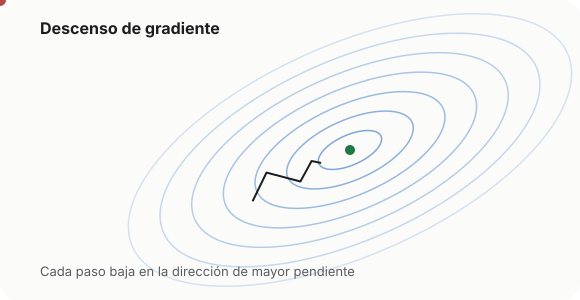
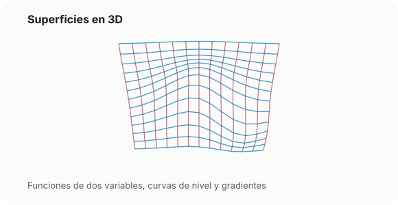
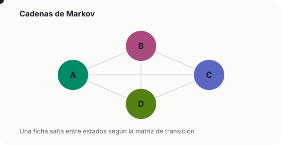

<div align="center">

<picture>
  <source media="(prefers-color-scheme: dark)" srcset=".github/readme/hero-dark.svg">
  
</picture>

<br>
<br>

**Aplicación web que explica los conceptos de la ciencia de datos con visualizaciones interactivas y animadas,**<br>
**desde los fundamentos matemáticos hasta el aprendizaje profundo, las series temporales y la inferencia causal.**

<br>

[Qué contiene](#qué-contiene) &nbsp;&nbsp;|&nbsp;&nbsp;
[Funciones](#funciones) &nbsp;&nbsp;|&nbsp;&nbsp;
[Ejecución local](#ejecución-local) &nbsp;&nbsp;|&nbsp;&nbsp;
[Agregar un concepto](#agregar-un-concepto) &nbsp;&nbsp;|&nbsp;&nbsp;
[Stack](#stack) &nbsp;&nbsp;|&nbsp;&nbsp;
[Licencia](#licencia)

</div>

<br>

## Cada idea se ve en movimiento

El Atlas no enseña bibliotecas ni herramientas: enseña el concepto. Cada ficha responde qué es, por qué funciona, cómo se ve y cómo se comporta cuando cambian sus parámetros. La visualización es la protagonista: muestras que se acumulan, algoritmos que iteran, densidades que se transforman y trayectorias que evolucionan.

<table>
  <tr>
    <td width="50%">
      <picture>
        <source media="(prefers-color-scheme: dark)" srcset=".github/readme/clt-dark.svg">
        
      </picture>
    </td>
    <td width="50%">
      <picture>
        <source media="(prefers-color-scheme: dark)" srcset=".github/readme/descent-dark.svg">
        
      </picture>
    </td>
  </tr>
  <tr>
    <td width="50%">
      <picture>
        <source media="(prefers-color-scheme: dark)" srcset=".github/readme/surface-dark.svg">
        
      </picture>
    </td>
    <td width="50%">
      <picture>
        <source media="(prefers-color-scheme: dark)" srcset=".github/readme/markov-dark.svg">
        
      </picture>
    </td>
  </tr>
</table>

Todas las visualizaciones comparten los mismos controles: reproducir, pausar, avanzar un paso, cambiar la velocidad, fijar la semilla aleatoria, ajustar parámetros con lecturas numéricas en vivo, pantalla completa y descarga en SVG o PNG.

## Qué contiene

El temario completo abarca una carrera de ciencia de datos en 18 módulos y más de 1600 conceptos. Las fichas se publican submódulo por submódulo, y cada concepto publicado tiene la suya.

<picture>
  <source media="(prefers-color-scheme: dark)" srcset=".github/readme/modules-dark.svg">
  
</picture>

Cada ficha tiene siempre la misma estructura:

| Sección                    | Qué aporta                                                             |
| -------------------------- | ---------------------------------------------------------------------- |
| Intuición                  | La idea sin fórmulas, con una situación concreta                       |
| Definición                 | El enunciado formal con sus supuestos y el significado de cada símbolo |
| Cómo usar la visualización | Qué controla cada parámetro y experimentos sugeridos                   |
| Ejemplo                    | Un caso resuelto paso a paso con números concretos                     |
| Propiedades                | Resultados derivados, con demostraciones plegables                     |
| Errores comunes            | Confusiones frecuentes y su corrección                                 |
| Conexiones                 | Enlaces a los conceptos relacionados                                   |
| Formulario                 | Todas las fórmulas de la ficha con cada parámetro explicado            |

Además de la visualización principal, los ejemplos, propiedades y errores comunes llevan sus propias figuras interactivas. El motor cuenta con más de 40 arquetipos reutilizables (explorador de distribuciones, simulador de muestreo, transformaciones matriciales, cadenas de Markov, trayectorias estocásticas, optimizadores, entre otros) y componentes dedicados para los conceptos emblemáticos.

## Funciones

| Función               | Descripción                                                                                                     |
| --------------------- | --------------------------------------------------------------------------------------------------------------- |
| Fichas de concepto    | Explicación completa con visualización interactiva, fórmulas renderizadas y navegación al concepto vecino       |
| Búsqueda instantánea  | Por nombre en español o inglés, alias y etiquetas; tolera errores de escritura y la falta de acentos (`Ctrl+K`) |
| Roadmap               | Dado un concepto objetivo, calcula el camino de prerrequisitos en orden de estudio, como diagrama o como lista  |
| Rutas de aprendizaje  | Recorridos por perfil: analista, estadístico, científico de datos, aprendizaje profundo, causalidad y más       |
| Mapa del conocimiento | Grafo navegable de todos los conceptos, con filtros y una vista agrupada por módulos                            |
| Progreso local        | Conceptos vistos y dominados guardados solo en el navegador, con exportación e importación en JSON              |

El sitio es estático, ofrece tema claro y oscuro, respeta `prefers-reduced-motion` y no usa analítica, rastreadores ni servicios externos.

## Ejecución local

Requiere Node.js 24 o posterior.

```bash
npm install
npm run dev
```

| Script                     | Acción                                                     |
| -------------------------- | ---------------------------------------------------------- |
| `npm run dev`              | Servidor de desarrollo con recarga del contenido           |
| `npm run build`            | Valida y genera el contenido, verifica tipos y construye   |
| `npm run preview`          | Sirve el build de producción                               |
| `npm run check`            | Lint, tipos, tipografía, validación de contenido y pruebas |
| `npm run test:e2e`         | Pruebas de extremo a extremo con Playwright                |
| `npm run content:validate` | Valida las fichas sin generar archivos                     |

## Agregar un concepto

Cada concepto es un archivo Markdown en `content/conceptos/<modulo>/<submodulo>/<id>.md`. El frontmatter declara el título en español e inglés, el nivel, los prerrequisitos directos, las etiquetas, un resumen, la fórmula principal, la visualización con sus parámetros y las referencias bibliográficas. El cuerpo usa las ocho secciones de la tabla anterior, en ese orden.

```yaml
id: teorema-de-bayes
titulo: Teorema de Bayes
titulo_en: Bayes' theorem
modulo: 1
submodulo: '1.2'
nivel: basico
prerrequisitos:
  - probabilidad-condicional
visualizacion:
  componente: BayesUpdater
publicado: true
```

`npm run content:validate` revisa que los identificadores sean únicos, que los prerrequisitos existan y no formen ciclos, que las secciones estén completas y en orden, que el LaTeX compile, que la visualización esté registrada y que los enlaces internos `[[id]]` apunten a conceptos existentes. Agregar un concepto no requiere tocar código, salvo que necesite una visualización nueva.

## Estructura

```
content/              fichas en Markdown, módulos, rutas, notación y sinónimos
scripts/              compilación y validación del contenido, verificación tipográfica
src/
  pages/              páginas de la aplicación
  components/         interfaz, fichas, grafo, búsqueda y roadmap
  visualizations/     núcleo, arquetipos y visualizaciones dedicadas
  lib/                matemáticas puras: aleatorios, distribuciones, álgebra lineal,
                      cálculo, optimización, procesos estocásticos y grafos
tests/                pruebas unitarias y de extremo a extremo
```

## Stack

TypeScript estricto, React 18, Vite y React Router. D3 sobre SVG y Canvas para las visualizaciones, incluidas las superficies y nubes de puntos en 3D, y KaTeX para las fórmulas. MiniSearch para la búsqueda, d3-force y dagre para el mapa y el roadmap, Zustand para el progreso y Zod para validar el contenido. Pruebas con Vitest y Playwright, despliegue con GitHub Actions y GitHub Pages.

## Licencia

Copyright (c) 2026 Mario Ureña García. El código y el contenido se distribuyen bajo la licencia [Creative Commons Atribución-NoComercial-CompartirIgual 4.0 Internacional](https://creativecommons.org/licenses/by-nc-sa/4.0/deed.es) (CC BY-NC-SA 4.0). Los términos completos están en `LICENSE`.

- Estudiantes y docentes pueden usar el Atlas como material de apoyo en cualquier clase, incluso en instituciones privadas, dando crédito a Mario Ureña García y al Atlas de Data Science.
- Las adaptaciones deben publicarse bajo la misma licencia.
- No se permite el uso comercial, lo que incluye ofrecer un curso, taller o producto de pago cuyo contenido principal sea el Atlas. Para un uso comercial se requiere una licencia aparte, que se solicita abriendo un issue en este repositorio.
